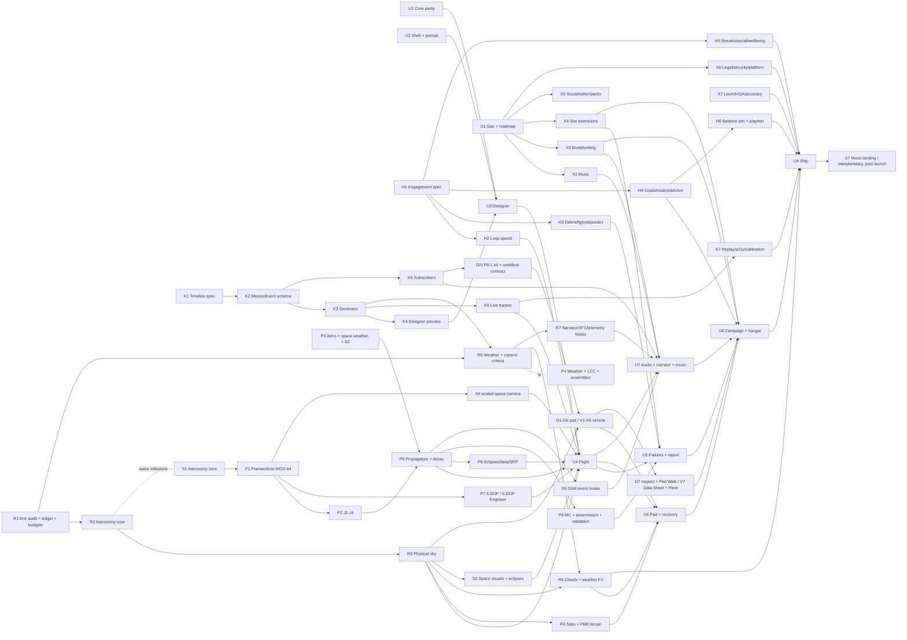

# Kestrel Heavy master roadmap

Ship target: **2.0 = first Unity release** (portrait, $0, offline-first). Build lanes U1–U9 (UNITY_SHIP_PLAN.md); spec/content lanes X1–X7 feed them.

## Dependency graph

## Critical path
U1 ∥ U2 → U3 → U4 → U7 (audio/narrator/music) → U8 → U9. X6 (privacy label, age rating, legal drafts) and X7 (test plan, device matrix) must close before U9 submission. Builds on Unity Build Automation only at milestones Trevor calls ready (~3/month free).

## Scope cut
| Tier | Scope |
|------|-------|
| **1.0 (2.0 build)** | U1–U7 + U9; U8 = tutorial, Codex L1, basic budget, hangar reveal, basic Photo Mode (#50). Music: motif + adaptive engine + generative/MIDI stems. Narrator library. Time warp (basic), weather + commit criteria (off in KID/Relaxed), replay, daily challenge (local seed), offline rule-based advisor, design codes (sanitized, offline). |
| **1.1** | Full economy + tech tree, rivals/light market, C1b/C1c/C3/C7, G7 Photo Mode full lens/filter suite + free-roam + Orbital Photographer achievements, Ultra quality, post-insertion ops, mission editor, JSON part packs, async ghosts via Game Center, iPad layout polish. |
| **Later** | Real-time multiplayer, visionOS/AR/Mac/TV (evaluate only), any backend, commissioned score. |

## Workstreams X1–X7
| WS | Deliverable | Lead | Support | Feeds |
|----|-------------|------|---------|-------|
| X1 | This doc set: GAP_ANALYSIS, MASTER_ROADMAP, PROJECT_STATE, DECISIONS | Kestrel Arcade | Chief of Staff | all |
| X2 | Music bible, cue sheet, Kestrel motif + variations, MIDI sketch script, Unity adaptive engine on placeholder stems, Music Lab, MUSIC_LICENSES.md | Sound | Gameplay Dev (engine), Narrator Voice (ducking) | U7 |
| X3 | World bible, fictional characters, skippable arc, rivals, light market, writing bible | Codex | Narrator Voice, UX | U7, U8 |
| X4 | Time warp, weather/commit criteria/windows, post-insertion scope, replay, challenge modes, offline rule-based advisor | Gameplay Dev | Physics, QA | U5, U8 |
| X5 | Async-first social, sanitized design codes, mission editor, JSON part packs (data only, never code) | Gameplay Dev | UX, QA | 1.0 codes, 1.1 rest |
| X6 | Legal/compliance pack ("draft for counsel"), security threat model, platform evaluation | Kestrel Arcade | Marketing, QA | U9 |
| X7 | Marketing, launch, beta, community, educators, live-ops + $0 cost model, accuracy review, master test plan, device matrix | Marketing | Physics (accuracy), QA (test/devices), Codex (educators) | U9 |

## Engagement H1–H6
See ENGAGEMENT_SPEC.md and UNITY_SHIP_PLAN §8. 1.0: H2, H3, H4 (campaign/sandbox/daily/weekly/12 lab challenges, advisor, PBs, Next-up), H5 (streaks, calm mode, Game Center boards), H6 playtests. 1.1: contract rush, failure investigation, more lab, A/B flip polish.

## Launch Timeline K1–K7
See MISSION_EVENTS.md and UNITY_SHIP_PLAN §9. All 1.0 except K7 achievements breadth (1.1). K2/K3 join the U1 critical path (one event schema before U3).

## Environment Realism R1–R7
See ENVIRONMENT_REALISM_AUDIT.md. Unity 6/URP, portrait, 120 Hz on ProMotion High tier, $0 CC0/procedural only (LICENSES.md ledger), fictional sites, reduced-flash safe. R1 audit (done) → R2 astronomy core ∥ U1 → R5 weather/commit criteria after K3 (is X4's weather item, uses `MissionEvent`) → R3 sky in U4 → R4 sites/terrain in U6 → R6 clouds/weather FX → R7 hooks in U7. Proposed 2.0: R1, R2, R3/R6 Low–Medium, R4 one site, R5, R7 core; 1.1: High volumetrics, planets, extra sites. Scope decisions pending with Chief of Staff (audit §8).

## Upper Atmosphere and Outer Space S1–S7
See SPACE_AUDIT.md. Shares astronomy (S1 = R2), atmosphere, body data and camera with R1–R7; nothing duplicated. 2.0 = Earth orbit only: true sky, Moon, eclipses, J2, orbital decay (S1–S6; the physics of S2/S3/S4-frames/S5-geometry now lives in P1–P8 below). S7 (lunar landing, interplanetary, solar-system view) is post-launch but `bodies.json` + SOI-ready propagator + scaled-space camera are built now. PD/CC0 data only, every licence logged in LICENSES.md; high-res planet textures are on-demand downloads.

### Approved scope (DECISIONS #38–#43)
All Env decisions approved; 120 Hz via Auto=High on ProMotion with governor → 60. Space #1–4, #6–9 approved; **no on-demand textures in 2.0** (space ≤ 8 MB in IPA). Extras: Kármán-line event + narrator line (S2/S6, U7), exposure model + dark-adapted eye + labelled cinematic assist (R3), near-silence in vacuum (U7 mixer), spent stages persist in orbit and decay (S3), basic Photo Mode in 2.0 (pause, orbit/rail camera, exposure + time-of-day, hide HUD, space-shot presets, share-sheet PNG only; DECISIONS #50), full suite 1.1, Codex Labs Orbit / Moon Phase / Sun-Sync / Exposure / Wind Shear (U8 Codex). LICENSES.md ledger live.
**Later question for Trevor:** high-res textures via Apple On-Demand Resources vs GitHub Releases (post-2.0; touches build config).

## Physics Core P1–P8 (2.0)
See PHYSICS_CORE_AUDIT.md (item status, golden vectors, tolerances, order). Pure C# core + golden vectors + `dotnet`
headless CLI. This section **replaces** the physics halves of S2, S3, S4 (frames), S5 (eclipse geometry) and R5; those
sections keep only their render/event halves. Astro #83 is validation category 1.

| P | Scope (2.0) | Absorbs | 1.1+ |
|---|---|---|---|
| P1 | ECI/ECEF, geodetic WGS-84, GMST/ERA, launch azimuth | S4 frames | polar motion, IAU-2006 CIO |
| P2 | J2+J3/J4 accel, secular rates, SSO, critical inc, mean↔osc | S3 J2 | tesseral geopotential |
| P3 | USSA76 0–1000 km (fixed), Jacchia-71-class with F10.7/Ap, seeded space-weather generator; **no NRLMSIS (licence)** | S2 density | detailed radiation |
| P4 | Seeded weather + upper winds, LCC, reduced ensembles | R5 = X4 weather | — |
| P5 | Coast propagator + handoff, drag decay, lifetime, Sutton–Graves heating | S3 propagator, S2 decay, spent-stage decay | SGP4/TLE, CW/rendezvous |
| P6 | Eclipses, β, cannonball SRP; Sun/Moon third-body for GTO/GEO secular drift only | S5 geometry | lunar patched-conic |
| P7 | 3-DOF default; 6-DOF Engineer (attitude, CN/CA, slosh, loads, PEG) | — | elastic modes |
| P8 | Reduced-fidelity MC; determinism (bit-exact per platform, tolerance across); 10-category validation suite | Astro #83, validation A–C | full-fidelity MC |

Order (Gameplay Dev implements, Physics validates first): P1 + CLI → P7 3-DOF → P2 → P5 coast/handoff → P3 → P5 decay/
lifetime/heating → P6 → P8 MC/determinism → P7 6-DOF; P4 in parallel after K3. One Core PR per effect (risk R19).

## Pad + Launch Vehicle Detail D1–D7 / V1–V7 (P0 for 2.0.0)
See PAD_VEHICLE_DETAIL_AUDIT.md. One sequenced P0 track (replaces the earlier rocket-detail pass), ahead of lower-priority R/S items for Graphics Dev. Deepens the U6 seeded pad generator (G2/G3) and the existing `RocketMeshBuilder` + U8 Hangar Reveal; no duplicate generator or renderer. Shared `Kestrel.Kit` materials/LOD/instancing, one pad–vehicle **umbilical contract** in Core, element graph + inspect mode, animation via `MissionEvent.links` (no new schema). Budgets: pad+vehicle ≤ 4 MB shipped, ≤ 250 k tris / ≤ 120 draws on Low. Procedural only; references logged in REFERENCE_LEDGER.md (text or US-Gov PD only, nothing from Trevor's workplace, no real designs/markings). Steps P0-1 kit+contract → P0-2 D1 ∥ V2 → P0-3 D2/D5 ∥ V1/V3 → P0-4 D3/D4 ∥ V4 → P0-5 D6 ∥ V5/V6 (after R3) → P0-6 D7 ∥ V7 (after K6). Scope approved (DECISIONS #46–#49, audit §11).

## Rocket Designer M1–M3 (2.0)
Owner: UX with Gameplay Dev. See UNITY_SHIP_PLAN §U3/U4 and GAP_ANALYSIS. M1 (Core design model, in U1) and M2 (DESIGN screen: stages, engines, propellant, structure, payload, recovery, cosmetics; live TWR/Δv/burn readouts, validation, "Make it fly", presets/saves, T1 templates, undo/symmetry, in U3) are merged. M3 is the flight half (U4: autopilot, staging, orbit determination, telemetry HUD, procedural vehicle renderer). M4–M6 follow per UNITY_SHIP_PLAN (U5, U8).

## Webcast narrator N1–N6 (2.0)
Owner: Narrator Voice (Gameplay Dev for bus/queue, Sound for mix, UX for subtitles). Lives in U7. Narration event bus, queue and director, subtitles, and a webcast overlay (mission clock, telemetry). Cast: mission control plus two webcast hosts (DECISIONS #55), a bundled ElevenLabs clip library pre-generated on Trevor's existing Creator plan, plus on-device TTS for player-specific strings only. No live server, no Fly.io, no new spend.

## Crew Talk (2.0)
Owners: Narrator Voice (voices), Codex (writing), Sound (mix). DECISIONS #54. Spanish-to-English crew lines for Bodie, Junie, Pearl and Sloane. The spoken line and the main English line keep the full meaning, rendered in each character's own dialect and style. Never canned stock lines, never literal translations. Lines are added to the ElevenLabs line list (NARRATION_LICENSE.md) and generated on the existing Creator plan.

## Education layer L1–L7 (2.0 vs 1.1 TBD)
Owner: Codex. Today the plan names Codex L1, moment cards and report explanations in 2.0 (U5, U8) and the educator kit X7 (GAP_ANALYSIS). Scope for each of L1–L7 (2.0 vs 1.1) is **TBD. Codex to propose** a breakdown for Chief of Staff and Trevor.

## Risk register
| # | Risk | L/I | Mitigation | Owner |
|---|------|-----|-----------|-------|
| R1 | 100 free Mac minutes run out (~3 builds/mo) | M/H | Milestone-only builds; Ubuntu dotnet CI daily | Kestrel Arcade |
| R2 | Unity ToS on agent automation | L/H | CLI-only; written OK from Unity support | Chief of Staff |
| R3 | Unity code uncompiled until first CLI open | H/M | Compile #13 stack before U3 | Graphics Dev |
| R4 | p95 frame >16.7 ms / thermal on floor device | M/H | G1 governor, quality Auto, perf gate at U4 | Graphics Dev |
| R5 | IPA >40 MB (URP + voice + music) | M/M | Drop OGG dupes, Addressables, audio budget | Sound, Art |
| R6 | Sim drift vs golden vectors | M/H | ε review every Core PR | Physics, Gameplay Dev |
| R7 | Music/voice rights unclear | L/H | MUSIC_LICENSES.md, NARRATION_LICENSE.md, originality rules | Sound, Narrator Voice |
| R8 | Kids audience triggers stricter rules | M/H | Explicit audience decision in X6; no analytics/ads | Trevor (decide), Kestrel Arcade |
| R9 | UI Toolkit accessibility gaps | M/M | Flat accessible menu; U9 budget | UX |
| R10 | Scope creep from "every topic" brief | H/M | 1.0/1.1/later cut above; X specs are docs first | Kestrel Arcade |
| R12 | Engagement features drift into dark patterns | L/H | Ban list + ethics PR checklist; negative-signal metrics | UX, QA |
| R13 | Predict/success probability too slow on device | M/M | Coarse N runs, Burst, cache per design hash | Gameplay Dev |
| R14 | Two event schemas creep back (narration vs SFX vs timeline) | M/M | One `MissionEvent`; PR review rule | Gameplay Dev |
| R15 | Timeline realism reads as copying a real vehicle | L/M | Fictional names, original wording, compressed times | Codex, Physics |
| R16 | Environment realism blows 8.3 ms @120 / IPA budget | M/H | Tiered techniques, env ≤ 8 MB, 120 Hz High-only, perf gate at U4/U6 | Graphics Dev |
| R17 | Asset licence contamination | L/H | CC0/PD only, LICENSES.md ledger with SHA-256, no Asset Store | Art, Kestrel Arcade |
| R18 | Lightning/flash harms photosensitive players | L/H | Reduced-flash rules + frame luminance test | UX, QA |
| R19 | J2/decay changes destabilise golden vectors | M/M | One Core PR per effect, Physics ε review | Physics |
| R20 | Float precision at orbital scale (jitter) | M/H | Double ECI sim, floating origin + scaled-space layer | Graphics Dev |
| R21 | Pad/vehicle detail blows Low-tier tris/draws | M/H | Kit instancing + LOD + impostors; perf gate after P0-3 and P0-6 | Graphics Dev |
| R22 | Detail reads as a specific real pad/vehicle | L/H | REFERENCE_LEDGER.md, no-direct-copy review, NAME_REVIEW for marks | Art, Kestrel Arcade |
| R11 | Name trademark conflict | L/H | X6 check, draft for counsel | Marketing |

## Owners
Parallel split (DECISIONS #45). Each owner edits only their paths; cross-path changes go through the owner.

| Owner | Scope | Paths |
|---|---|---|
| Graphics Dev | D1–D7, R visuals, shared kit, umbilical contract | `Pad/**`, `Kit/**`, `Environment/**` |
| Art | V1–V6 | `Vehicle/**`, `Art/Vehicle/**`, `Livery/**` |
| Gameplay Dev | P1–P8 implementation (was S2/S3), P4 weather/commit (R5), Data Sheet numbers, V7 Fleet | `Kestrel.Core/**` (except Astro), `data/**` |
| Physics | P1–P8 validation + PHYSICS.md + PHYSICS_CORE_AUDIT.md, validation suites, PAD_ENGINEERING_RULES.md, VEHICLE_ENGINEERING_RULES.md | `docs/PAD_ENGINEERING_RULES.md`, `docs/VEHICLE_ENGINEERING_RULES.md`, validation tests |
| Sound | Pad/vehicle sound anchors, vacuum silence | `Audio/**` |
| Codex | Labs | `Codex/**` |
| UX | Data Sheet, Fleet, inspect and Photo Mode screens | `UI/Screens/**` |
| QA | CI, golden images, regression | `.github/workflows/**`, `tests/golden-images/**` |
| Kestrel Arcade | Lead/integrator, merge queue, sole Unity CLI driver | integration (`SliceApp`/scene wiring) |

Also: Narrator Voice (scripts/clips) · Marketing (launch/store).

Decision log: DECISIONS.md. Living context: PROJECT_STATE.md.
