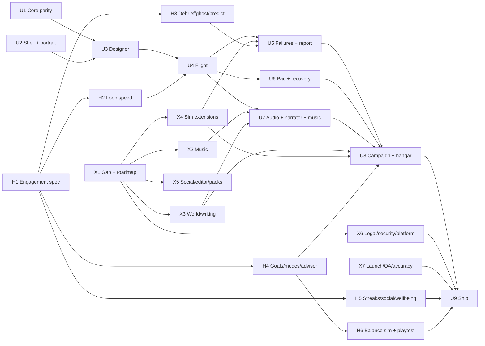

# Kestrel Heavy master roadmap

Ship target: **2.0 = first Unity release** (portrait, $0, offline-first). Build lanes U1–U9 (UNITY_SHIP_PLAN.md); spec/content lanes X1–X7 feed them.

## Dependency graph

## Critical path
U1 ∥ U2 → U3 → U4 → U7 (audio/narrator/music) → U8 → U9. X6 (privacy label, age rating, legal drafts) and X7 (test plan, device matrix) must close before U9 submission. Builds on Unity Build Automation only at milestones Trevor calls ready (~3/month free).

## Scope cut
| Tier | Scope |
|------|-------|
| **1.0 (2.0 build)** | U1–U7 + U9; U8 = tutorial, Codex L1, basic budget, hangar reveal. Music: motif + adaptive engine + generative/MIDI stems. Narrator library. Time warp (basic), weather + commit criteria (off in KID/Relaxed), replay, daily challenge (local seed), offline rule-based advisor, design codes (sanitized, offline). |
| **1.1** | Full economy + tech tree, rivals/light market, C1b/C1c/C3/C7, G7 photo mode, Ultra quality, post-insertion ops, mission editor, JSON part packs, async ghosts via Game Center, iPad layout polish. |
| **Later** | Real-time multiplayer, visionOS/AR/Mac/TV (evaluate only), any backend, commissioned score. |

## Workstreams X1–X7
| WS | Deliverable | Lead | Support | Feeds |
|----|-------------|------|---------|-------|
| X1 | This doc set: GAP_ANALYSIS, MASTER_ROADMAP, PROJECT_STATE, DECISIONS | Kestrel Arcade | Chief of Staff | all |
| X2 | Music bible, cue sheet, Kestrel motif + variations, MIDI sketch script, Unity adaptive engine on placeholder stems, Music Lab, MUSIC_LICENSES.md | Sound | Gameplay Dev (engine), Narrator Voice (ducking) | U7 |
| X3 | World bible, fictional characters, skippable arc, rivals, light market, writing bible | Codex | Narrator Voice, UX | U7, U8 |
| X4 | Time warp, weather/commit criteria/windows, post-insertion scope, replay, challenge modes, offline rule-based advisor | Gameplay Dev | Physics, QA | U5, U8 |
| X5 | Async-first social, sanitized design codes, mission editor, JSON part packs (data only, never code) | Gameplay Dev | UX, QA | 1.0 codes, 1.1 rest |
| X6 | Legal/compliance pack ("draft for counsel"), security threat model, platform evaluation | Kestrel Arcade | Marketing, QA | U9 |
| X7 | Marketing, launch, beta, community, educators, live-ops + $0 cost model, accuracy review, master test plan, device matrix | Marketing | Physics (accuracy), QA (test/devices), Codex (educators) | U9 |

## Engagement H1–H6
See ENGAGEMENT_SPEC.md and UNITY_SHIP_PLAN §8. 1.0: H2, H3, H4 (campaign/sandbox/daily/weekly/12 lab challenges, advisor, PBs, Next-up), H5 (streaks, calm mode, Game Center boards), H6 playtests. 1.1: contract rush, failure investigation, more lab, A/B flip polish.

## Risk register
| # | Risk | L/I | Mitigation | Owner |
|---|------|-----|-----------|-------|
| R1 | 100 free Mac minutes run out (~3 builds/mo) | M/H | Milestone-only builds; Ubuntu dotnet CI daily | Kestrel Arcade |
| R2 | Unity ToS on agent automation | L/H | CLI-only; written OK from Unity support | Chief of Staff |
| R3 | Unity code uncompiled until first CLI open | H/M | Compile #13 stack before U3 | Graphics Dev |
| R4 | p95 frame >16.7 ms / thermal on floor device | M/H | G1 governor, quality Auto, perf gate at U4 | Graphics Dev |
| R5 | IPA >40 MB (URP + voice + music) | M/M | Drop OGG dupes, Addressables, audio budget | Sound, Art |
| R6 | Sim drift vs golden vectors | M/H | ε review every Core PR | Physics, Gameplay Dev |
| R7 | Music/voice rights unclear | L/H | MUSIC_LICENSES.md, NARRATION_LICENSE.md, originality rules | Sound, Narrator Voice |
| R8 | Kids audience triggers stricter rules | M/H | Explicit audience decision in X6; no analytics/ads | Trevor (decide), Kestrel Arcade |
| R9 | UI Toolkit accessibility gaps | M/M | Flat accessible menu; U9 budget | UX |
| R10 | Scope creep from "every topic" brief | H/M | 1.0/1.1/later cut above; X specs are docs first | Kestrel Arcade |
| R12 | Engagement features drift into dark patterns | L/H | Ban list + ethics PR checklist; negative-signal metrics | UX, QA |
| R13 | Predict/success probability too slow on device | M/M | Coarse N runs, Burst, cache per design hash | Gameplay Dev |
| R11 | Name trademark conflict | L/H | X6 check, draft for counsel | Marketing |

## Owners
Kestrel Gameplay Dev (sim/core/HUD/economy) · Graphics Dev (render/shell/pad/hangar) · Sound (SFX/music) · Codex (edu/world) · Narrator Voice (scripts/clips) · Marketing (launch/store) · Physics (accuracy) · QA (tests/devices) · UX (flows/a11y) · Art (style/assets).

Decision log: DECISIONS.md. Living context: PROJECT_STATE.md.
